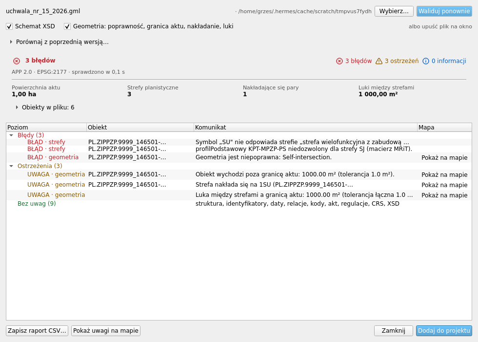
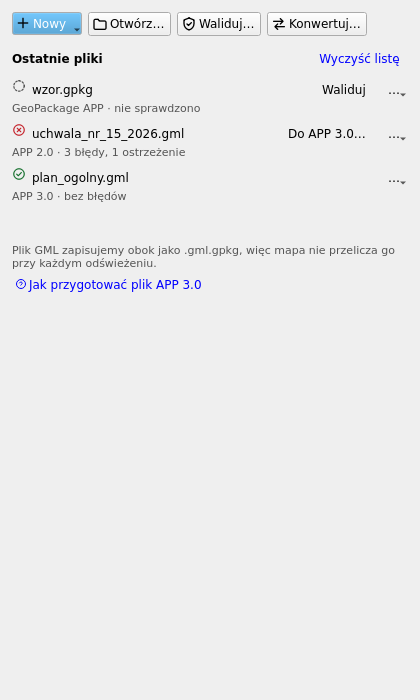
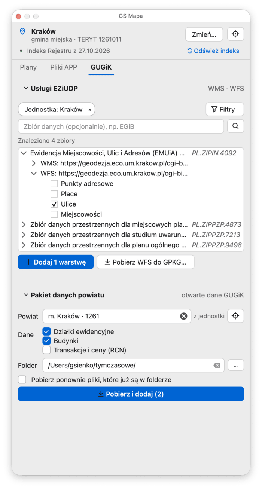

# GS Mapa

**Plany zagospodarowania, mapy podkładowe i pliki APP — prosto w QGIS.**

GS Mapa to wtyczka do [QGIS](https://qgis.org) 4, która w jednym panelu daje dostęp do
Rejestru Urbanistycznego, map podkładowych i usług GUGiK, a pliki aktów planowania
przestrzennego (APP) pozwala otwierać, tworzyć i walidować — bez bazy danych
i bez przełączania się między przeglądarką a QGIS-em.

`Wersja 0.1.0` · `QGIS 4.0+` · `Windows · macOS · Linux` · `GPL-2.0-or-later`

## Co potrafi

* **Plany na mapie** — plany ogólne (z oficjalną symboliką z rozporządzenia), miejscowe,
  zintegrowane i wojewódzkie z Rejestru Urbanistycznego.
* **Informacja o planie** — klikasz w plan i widzisz jego akt, status i dokumenty;
  dokument otworzysz w przeglądarce albo od razu dodasz do mapy.
* **Mapy podkładowe** — OpenStreetMap i BDOT10k, jako raster (wygląd jak w przeglądarce)
  albo wektor (obiekty z atrybutami).
* **Dane GUGiK** — wyszukiwanie zbiorów EZiUDP (także w miejscu wskazanym na mapie),
  dodawanie usług WMS / WMTS / WFS, pobieranie WFS do GeoPackage oraz pakiet danych
  powiatu: działki i budynki z EGiB, transakcje z Rejestru Cen Nieruchomości.
* **Pliki APP** — dodawanie aktu GPKG/GML z oficjalnymi stylami, walidacja GML APP 2.0 i 3.0,
  konwersja starszych wersji do APP 3.0, kreator nowego aktu i wzorcowy GeoPackage.
* **Jeden panel** — trzy karty (Plany, Pliki APP, GUGiK) i pasek narzędzi, niezależne od
  stylu Qt w systemie: jasny i ciemny motyw wyglądają tak samo dobrze.

## Panel

Panel otworzysz z paska narzędzi **GS Mapa** (przycisk *Panel GS Mapa*) albo z menu
*Wtyczki → GS Mapa*.

### Plany

Lista aktów planistycznych wybranej jednostki i warstwy krajowe Rejestru Urbanistycznego.
Plany dodajesz do projektu jednym kliknięciem, z gotowymi stylami — także dla planu
ogólnego, gdzie stylowanie idzie za rozporządzeniem. Narzędzie **Informacja o planie**
(pasek narzędzi) odpowiada na pytanie „co tu obowiązuje?” dla miejsca wskazanego na mapie.

### Pliki APP

Otwieranie, walidacja i konwersja plików aktów planowania przestrzennego, a także kreator
nowego aktu. Walidacja sprawdza urzędowe XSD, reguły specyfikacji (identyfikatory, relacje,
listy kodowe, OCL) oraz geometrię — poprawność, granicę aktu, nakładanie się stref i luki
między nimi. Wynik dostajesz jako listę błędów i ostrzeżeń z przejściem do obiektu na mapie,
raport CSV i warstwę błędów w projekcie.

### GUGiK

Wyszukiwarka zbiorów zgłoszonych do Ewidencji Zbiorów i Usług Danych Przestrzennych
(EZiUDP) i dodawanie ich usług WMS, WMTS i WFS. Obok — pakiet danych powiatu z otwartych
danych GUGiK: wybierasz powiat z listy albo z mapy, a wtyczka pobiera pliki i dodaje
warstwy do projektu.

## Instalacja

1. Pobierz `gs_mapa.zip` z zakładki [Releases](../../releases).
2. W QGIS: *Wtyczki → Zarządzaj i instaluj wtyczki → Zainstaluj z pliku ZIP* i wskaż
   pobrane archiwum.
3. Zaznacz wtyczkę na liście i kliknij *Włącz* — w menu *Wtyczki* pojawi się **GS Mapa**.

Aktualizacja: nadpisz wtyczkę nowszym ZIP-em w ten sam sposób i uruchom QGIS ponownie —
działający QGIS trzyma w pamięci kod wtyczki wczytany przy starcie.

## Pierwsze kroki

1. Otwórz panel **GS Mapa** i w pasku u góry wybierz gminę (albo województwo) —
   wtyczka pobierze indeks aktów Rejestru Urbanistycznego.
2. **Plany** — wybierz akt z listy, żeby dodać jego warstwy do projektu.
3. **Pliki APP** — *Otwórz…* istniejący plik aktu albo *Nowy…*, żeby utworzyć go kreatorem.
4. **GUGiK** — wyszukaj zbiór danych albo pobierz pakiet powiatu.

## Wymagania

| Element | Wersja |
|---|---|
| QGIS | 4.0 lub nowszy (testowane na 4.2.3) |
| System | Windows, macOS, Linux |
| Połączenie z internetem | tak — dane pochodzą z Rejestru Urbanistycznego, serwera kafli GS Mapa i usług GUGiK |

## Skąd pochodzą dane

| Dane | Źródło |
|---|---|
| Plany i akty (Rejestr Urbanistyczny) | kafle PMTiles i pliki aktów GS Mapa |
| Mapy podkładowe (OpenStreetMap, BDOT10k) | serwer kafli `gs-mapa.cloud` |
| Usługi i zbiory EZiUDP, ULDK | GUGiK (`integracja.gugik.gov.pl`, `uldk.gugik.gov.pl`) |
| Otwarte dane powiatów | GUGiK / dane.gov.pl |
| Pliki APP użytkownika | pliki lokalne (GPKG, GML) |

## Wsparcie

* Błąd albo pomysł: [Issues](../../issues).
* Kontakt: gsienko@gis-serwer.pl

## Kod źródłowy

To repozytorium zawiera wyłącznie wydania wtyczki: pakiet `gs_mapa/`,
README, licencję i archiwa ZIP w zakładce *Releases*. Repozytorium z kodem
źródłowym, testami i dokumentacją wewnętrzną jest prywatne — zmiany trafiają
tu razem z kolejnymi wydaniami.

## Licencja

GPL-2.0-or-later — pełny tekst w [`LICENSE`](LICENSE).
